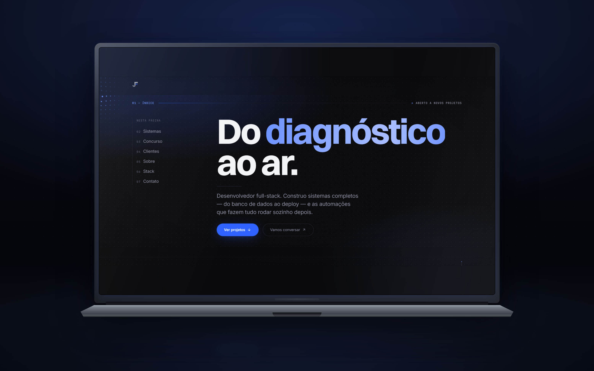

# 🔵 Jardson Florentino — Portfólio Full-Stack



Portfólio pessoal construído como **o primeiro case study do próprio portfólio**. 7 seções, matriz de pontos reativa em canvas, camada de atmosfera em CSS puro, bilíngue PT/EN e um orçamento de performance tratado como requisito, não como meta.

---

## 🌐 Aplicação Online

**🔗 Site:** [https://jardsonflorentino.com.br](https://jardsonflorentino.com.br)

> 💡 Recarregue a página para ver a abertura completa — o headline sobe de dentro da máscara palavra por palavra, e a matriz de pontos do hero dispara uma onda de entrada antes de passar a responder ao seu cursor.

### 🎮 Interações escondidas

| Ação | Resultado |
|------|-----------|
| **Mova o cursor** no hero | A matriz de pontos se adensa e brilha em volta do ponteiro |
| **Passe o mouse** no retrato (Sobre) | Uma máscara radial devolve a cor original só onde você aponta |
| **Passe sobre** um trabalho de cliente | O thumbnail do projeto aparece grudado no cursor e acompanha o movimento |
| **Aproxime-se** dos CTAs do hero | Os botões são magnéticos: inclinam na direção do ponteiro antes do clique |
| **Role em qualquer lugar** | Barra de progresso no topo, sem uma linha de JavaScript |
| **Role no celular** | Sem cursor, a matriz troca de fonte de reação e passa a responder ao scroll |
| **Passe o mouse** no botão do WhatsApp | As ondas param — quem já achou o botão não precisa mais ser chamado |
| **Ligue `prefers-reduced-motion`** | Nada trava no meio: cada efeito tem um estado final legível definido à mão |

---

## 📝 Sobre o projeto

Portfólio pessoal com posicionamento declarado: **desenvolvedor full-stack que entrega sistemas completos, do banco de dados ao deploy.** Não "desenvolvedor React", não "freelancer web".

O princípio de construção foi direto: se o site afirma que eu construo sistemas rápidos e completos, ele precisa ser um sistema rápido e completo. O código é público porque **o repositório é parte do argumento** — um recrutador consegue verificar a afirmação sem precisar acreditar nela.

Direção de arte **dark premium** com um único acento: ultramarino elétrico `#2E63FF`. Um acento só, disciplinadamente — é o que separa "sofisticado" de "carnaval".

E uma diferença que vale registrar: **todo o conteúdo aqui é real e verificável.** Os sistemas estão no ar, as métricas vieram de clientes reais, os links funcionam.

---

## ✨ Destaques

### Matriz de pontos reativa no hero
- Canvas com grade de 17 px — cerca de 4.000 pontos numa tela de 1440×800 — com densidade e brilho respondendo à distância do ponteiro
- Onda de entrada que percorre a grade na abertura, antes de qualquer interação
- No toque, a mesma cena troca de motor: passada a onda de entrada o loop **para**, e quem reacende é o scroll
- Zero estado do React no caminho — coordenadas viram custom properties CSS dentro de `requestAnimationFrame`

### Camada de atmosfera sem custo de frame
- Grid blueprint, fonte de luz azul, vinheta e grão: quatro camadas empilhadas em **CSS estático**
- Nenhuma delas anima. O efeito visual de uma aurora sem pagar `blur(100px)` em loop
- A luz que segue o cursor é um único gradiente radial cuja posição vem de `--mx`/`--my`

### Reveal de entrada em CSS, não em JavaScript
- O headline sobe de dentro de um container `overflow: hidden`, palavra por palavra, com desfoque saindo
- Roda na abertura da página, quando o JS ainda pode não ter hidratado — é exatamente por isso que não usa Framer Motion

### Barra de progresso com zero JavaScript
- `animation-timeline: scroll(root block)` — animação guiada por scroll nativa do browser
- Onde não há suporte, simplesmente não aparece. Nenhum listener, nenhum fallback pesado

### Seis efeitos de ponteiro, nenhum re-render
| Efeito | Onde |
|--------|------|
| **Matriz reativa** | Hero — canvas com densidade por distância |
| **Luz do cursor** | Página inteira — gradiente radial em `--mx`/`--my` |
| **Revelação do retrato** | Sobre — máscara radial em `--px`/`--py` |
| **Thumbnail flutuante** | Trabalhos para cliente — imagem colada no ponteiro |
| **Botões magnéticos** | CTAs do hero — `translate` proporcional ao offset |
| **Ondas do FAB** | WhatsApp — três anéis defasados propagando para fora |

---

## 🛠️ Stack Tecnológica

### Core
- **Next.js 14** (App Router) — Server Components de verdade: a maior parte da página chega como HTML pronto, sem custo de hidratação
- **TypeScript** — contrato tipado de ponta a ponta, do dado ao componente
- **Tailwind CSS 3.4** — design system como tokens em `tailwind.config.ts`, não como folha de estilo paralela

### Animação
- **CSS puro** — reveal de entrada, realce tipográfico em gradiente, ticker da stack, ondas do botão flutuante, barra de progresso
- **Canvas 2D** (sem biblioteca) — a matriz do hero recalcula milhares de pontos por frame; qualquer abstração aqui seria overhead sem ganho
- **Framer Motion** — reservado a 3 componentes (`HeroShell`, `Header`, `SlideUp`), só onde há de fato estado de scroll ou de viewport
- **Lenis** — smooth scroll sem sequestrar acessibilidade nem quebrar `scroll-behavior`

### Dados e formulário
- **React Hook Form + Zod** — validação sem re-render por tecla, e um schema único compartilhado entre cliente e servidor
- **Resend via REST** — `fetch` direto na API em vez do SDK: ~200 KB de bundle evitados

### Internacionalização e SEO
- **next-intl** — PT e EN com rota própria por idioma e paridade de chaves verificada (119 chaves, zero divergência)
- **generateMetadata + JSON-LD** — `alternates`, OG e Twitter card por locale, `schema.org/Person` na raiz

### Infraestrutura
- **Vercel** — deploy contínuo a cada push
- **next/font** — Switzer variável (local) + Inter + JetBrains Mono, zero CLS
- **lucide-react** — ícones de interface

---

## 🧠 Decisões técnicas

### Por que Server Components por padrão?

`"use client"` só aparece onde existe interação real. O Hero renderiza no servidor; o wrapper que aplica a transformação de scroll é um cliente fino que recebe o conteúdo por **slots**. O texto do LCP não espera JavaScript para existir.

O padrão que se repete no projeto: o Server Component monta o conteúdo, o Client Component só aplica o movimento.

### Por que canvas puro e não uma biblioteca de partículas?

A matriz do hero recalcula distância, densidade e alfa de milhares de pontos a cada frame, com duas fontes de reação distintas (cursor no desktop, scroll no toque). Canvas 2D dá acesso direto ao contexto sem camada intermediária. Uma biblioteca resolveria o caso genérico e cobraria por ele.

O espaçamento também muda por dispositivo: 17 px no desktop, 22 px no mobile. Menos pontos onde há menos GPU.

### Efeito de cursor nunca passa por estado do React

Este é o erro que transforma um efeito bonito em travamento: um `setState` por evento de `pointermove` significa re-render a 60 fps, com toda a árvore reconciliando.

Todos os seis efeitos de ponteiro do site escrevem **custom properties CSS dentro de `requestAnimationFrame`** e leem posição por `ref`. O React renderiza uma vez e sai do caminho. O thumbnail de projeto, por exemplo, tem opacidade alternada por `ref` e posição por variável CSS — zero re-render em todo o percurso do mouse.

### `IntersectionObserver`, nunca listener de scroll

Detectar seção visível lendo `offsetTop` a cada evento de scroll força **reflow sincrônico no meio do frame** — o browser precisa recalcular layout para responder. O observer entrega a mesma informação sem tocar em layout.

É assim que o header muda ao rolar, que o botão flutuante aparece depois do hero, e que os loops de canvas pausam quando saem da viewport.

### Mobile não é o desktop encolhido

Foi a correção mais estrutural do projeto. Três coisas quebravam no toque e nenhuma aparecia no navegador do desenvolvedor:

- **A matriz não reagia a nada**, porque a única fonte de reação era o cursor. Hoje troca de motor: acabada a onda de entrada, o loop para e o scroll reacende.
- **20 logos da stack sem rótulo**, porque o nome só aparecia no hover. A lógica foi invertida: visível é o padrão, o hover só realça.
- **Duas faixas de projeto sem imagem**, porque o thumbnail seguia o cursor. No toque ele volta inline, em 80×56, dentro do próprio card.

O corte é feito por `[@media(pointer:fine)]`, não por largura de tela — a pergunta certa é "existe ponteiro preciso?", não "a tela é grande?".

### Um schema, dois lados

O `contactSchema` do Zod valida no navegador **e** na Route Handler. Não existe caminho em que cliente e servidor divirjam sobre o que é uma mensagem válida — o mesmo objeto é a fonte da verdade para os dois.

### Contraste medido, não estimado

A cor dos labels mono estava em **3.07:1** — falhava WCAG AA em texto pequeno, e era justamente a cor de todo metadado do site. Corrigida para **5.04:1**.

A borda dos campos de formulário ganhou token próprio em **3.33:1** para atender o critério **1.4.11** (contraste de componente de interface). Hairline fraca em card decorativo é escolha estética legítima; em campo de formulário é falha de conformidade — o usuário precisa enxergar onde o campo começa.

### `prefers-reduced-motion` caso a caso, não como interruptor

Desligar tudo de uma vez deixa efeito congelado no meio. Cada animação tem estado final definido à mão: o reveal termina **legível** em vez de parar desfocado, as ondas do botão **desaparecem inteiras** em vez de travar a meio caminho, a luz do cursor sai de cena.

### Nenhum arquivo sem uso

Tokens de motion que ninguém importa, componentes órfãos e variantes de logo vazias não são design system — são dívida com boa aparência. O projeto passou por uma varredura de referências reais: 17 arquivos e 9 exports mortos saíram, e `public/` caiu de 8.0 MB para 4.4 MB.

E `lib/constants.ts` é fonte única de verdade: nenhum email, link ou handle é escrito inline em componente. Um contato errado espalhado por dez arquivos são dez bugs — o projeto já pagou esse preço uma vez.

---

## 📊 Orçamento de performance

Tratado como requisito de aceite, não como aspiração:

| Métrica | Alvo |
|---------|------|
| LCP | < 2.0 s |
| CLS | < 0.05 |
| INP | < 100 ms |
| Bundle JS | < 150 KB gzipped |

As leis que sustentam esses números:

- Animar **apenas `transform` e `opacity`**. Nunca `width`, `height`, `top`, `left` ou `padding` — essas causam layout a cada frame
- `next/image` em toda imagem, `width`/`height` sempre definidos, `priority` só no hero
- Máximo duas famílias tipográficas, via `next/font`, preload automático
- Rotas geradas estaticamente por locale — sem cair em renderização dinâmica

> ⚠️ Números de Lighthouse só valem medidos em build de produção (`npm run build && npm start`). Em `dev` o resultado não representa nada.

---

## ♿ Acessibilidade

- **Skip link** como primeiro elemento tabulável da página
- **Formulário com ARIA de verdade** — `aria-invalid`, `aria-describedby`, `role="alert"` e `aria-busy` ligados aos campos e ao estado de envio, não decorativos
- **Ordem de tabulação correta** — a navegação do header usa `invisible`, não `opacity-0`: elemento transparente continua tabulável e captura foco invisível
- **Alvos de toque em 44 px ou mais** (o botão flutuante tem 56 px)
- **`:focus-visible`** com contorno próprio; foco por clique não desenha contorno
- **Nenhum conteúdo exclusivo de hover** — tudo que o cursor revela tem caminho equivalente no toque

---

## 📦 Instalação Local

### Pré-requisitos
- Node.js 18+
- npm

```bash
# Clone o repositório
git clone https://github.com/JardsonFlorentino/jardson-portfolio
cd jardson-portfolio

# Instale as dependências
npm install

# Inicie o servidor de desenvolvimento
npm run dev
```

Acesse `http://localhost:3000` — você será redirecionado para `/pt`.

### ⚠️ Duas coisas precisam existir antes do primeiro build

**1. A fonte display.** Switzer é gratuita mas não vem do npm. Baixe em [fontshare.com/fonts/switzer](https://www.fontshare.com/fonts/switzer) e coloque o arquivo **variável** em:

```
public/fonts/Switzer-Variable.woff2
```

**2. O envio de email.** Crie `.env.local` na raiz:

```env
RESEND_API_KEY=re_sua_chave
CONTACT_FROM=contato@seudominio.com
```

Sem essas variáveis o formulário não quebra: responde com uma mensagem orientando o visitante ao WhatsApp. Falhar em silêncio é o pior comportamento possível num formulário de contato.

### Scripts

| Comando | O que faz |
|---------|-----------|
| `npm run dev` | Servidor de desenvolvimento |
| `npm run build` | Build de produção |
| `npm start` | Serve o build — é aqui que se mede performance |
| `npm run lint` | ESLint |
| `npm run type-check` | `tsc --noEmit` |

---

## 📁 Estrutura de Pastas

```
src/
├── app/
│   ├── [locale]/
│   │   ├── layout.tsx       # Fontes, JSON-LD, overlays globais, metadata
│   │   └── page.tsx         # Composição das 7 seções
│   ├── api/contact/         # Route Handler do formulário (Resend via fetch)
│   ├── globals.css          # Atmosfera, reveal, ondas, reduced-motion
│   ├── icon.svg             # Favicon, apple-icon e imagens sociais
│   └── opengraph-image.png  #   por convenção de arquivo do Next
├── components/
│   ├── hero/
│   │   ├── DotMatrix.tsx    # Canvas reativo — cursor no desktop, scroll no toque
│   │   ├── HeroIndex.tsx    # Índice navegável (trilho vertical / faixa horizontal)
│   │   └── HeroShell.tsx    # Cliente fino: aplica transformação de scroll por slots
│   ├── layout/              # Header, Footer, troca de idioma
│   ├── motion/              # SlideUp, WordReveal
│   ├── sections/            # Hero, Projects, About, Stack, Contact, ClientWorkList
│   └── ui/                  # Atmosphere, CursorGlow, MagneticLink, PortraitReveal,
│                            #   ScrollProgress, WhatsAppFab, Mark, BrandMark
├── data/
│   ├── projects.ts          # Todo o conteúdo de projeto (nunca hardcoded no JSX)
│   ├── brands.ts            # 21 paths da simple-icons inlinados em currentColor
│   └── blur.ts              # Placeholders de blur para next/image
├── hooks/                   # useReducedMotion
└── lib/                     # constants (fonte única), fonts, schemas, motion, utils

messages/
├── pt.json                  # 119 chaves
└── en.json                  # 119 chaves — paridade verificada
```

---

## 🎨 Design System

### Cor

| Token | Valor | Uso |
|-------|-------|-----|
| `bg` | `#07070A` | Fundo base |
| `surface` | `#0E0E13` | Cards e superfícies elevadas |
| `accent` | `#2E63FF` | Ultramarino elétrico — o único acento |
| `accent-bright` | `#6E93FF` | Texto e ícone de acento sobre fundo escuro |
| `fg` | `#F2F3F7` | Texto principal — 18.1:1 |
| `fg-muted` | `#8E8FA0` | Texto secundário — 6.3:1 |
| `fg-dim` | `#7C7E92` | Labels mono — 5.04:1 |
| `line-field` | `#63647A` | Borda de campo de formulário — 3.33:1 (WCAG 1.4.11) |

> Sobre o azul: o problema nunca foi a cor, foi o **tom**. `#3B82F6` é literalmente o `blue-500` do Tailwind — o azul mais usado da internet. `#2E63FF` é a mesma família com muito mais voltagem, e não parece template.

### Tipografia

Escada de razão ~1.45, medida em 1440 px. Cada tamanho tem **um** papel — foi a correção que devolveu hierarquia ao topo do site:

| Token | Tamanho | Papel |
|-------|---------|-------|
| `display-xl` | 80 px | Hero, e só o hero |
| `heading` | 40 px | Títulos de seção |
| `title` | 27 px | Títulos de card |
| `lede` | 20 px | Parágrafo de abertura |
| `body` | 16 px | Texto corrido |
| `meta` | 12 px | Mono, caixa alta, tracking 0.09em |

### Movimento

Easing `cubic-bezier(0.16, 1, 0.3, 1)` (exponencial out) como padrão, durações de 200 ms a 700 ms, entradas com `opacity 0→1` + `translateY` e stagger de 100 ms. Sem bounce, sem elastic, sem rotação decorativa.

A exceção é deliberada: as ondas do botão flutuante usam `linear`. Com a exponencial out o anel salta a 2× nos primeiros 25% e depois rasteja — as três ondas empilhavam na borda e o momento de sair do botão era um piscar. Onda que se propaga anda em velocidade constante.

---

## 🙏 Créditos

- **Switzer** — fonte display de [Fontshare](https://www.fontshare.com/fonts/switzer), licença gratuita
- **simple-icons** (CC0) — os 21 paths de marca usados no site foram extraídos e inlinados em `currentColor`, sem entrar como dependência. As marcas pertencem aos respectivos donos
- **Lucide** — ícones de interface
- **Lenis** — smooth scroll

Conteúdo, textos, métricas e identidade visual são próprios. Os sistemas listados estão em produção e as métricas vieram de clientes reais.

---

## 🙋‍♂️ Autor

**Jardson Florentino**
Desenvolvedor Full-Stack · Maragogi — AL, Brasil

- 🌐 [Portfólio](https://jardsonflorentino.com.br)
- 💼 [LinkedIn](https://www.linkedin.com/in/jardsonflorentino/)
- 🐙 [GitHub](https://github.com/JardsonFlorentino)
- 📸 [Instagram](https://www.instagram.com/jardson_dev/)
- 💬 [WhatsApp](https://wa.me/5581986438384)
- 📧 [jardsonflorentino@gmail.com](mailto:jardsonflorentino@gmail.com)

Resposta em até 24 horas.
